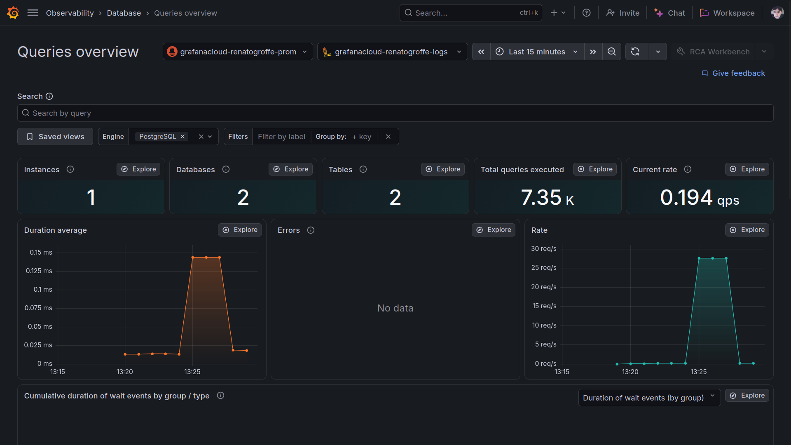
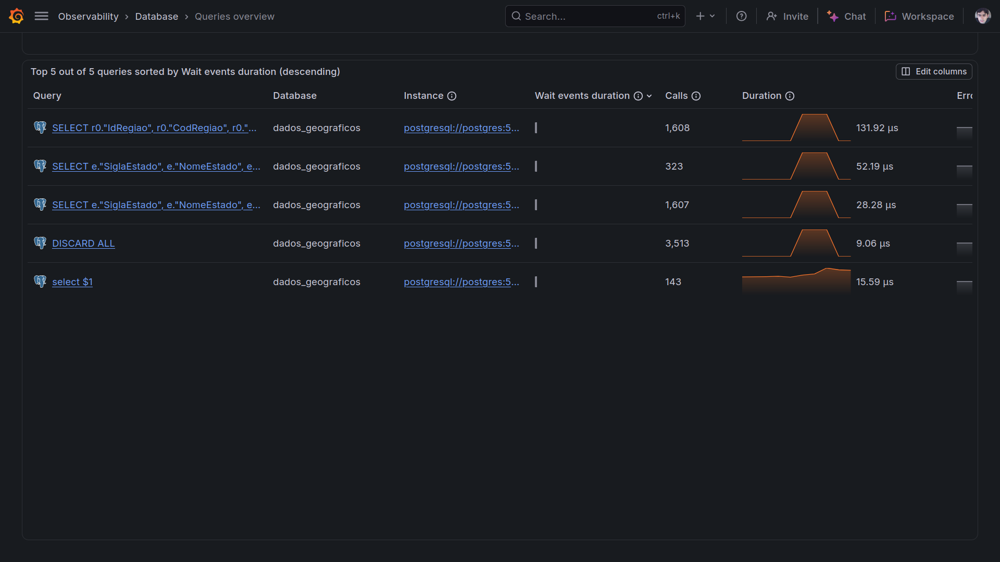
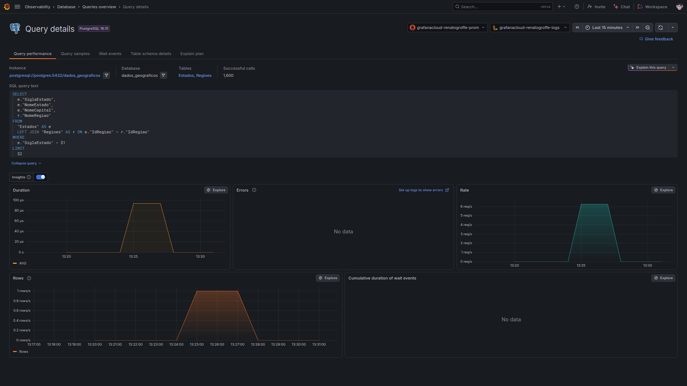
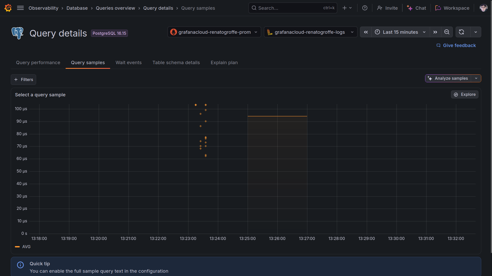
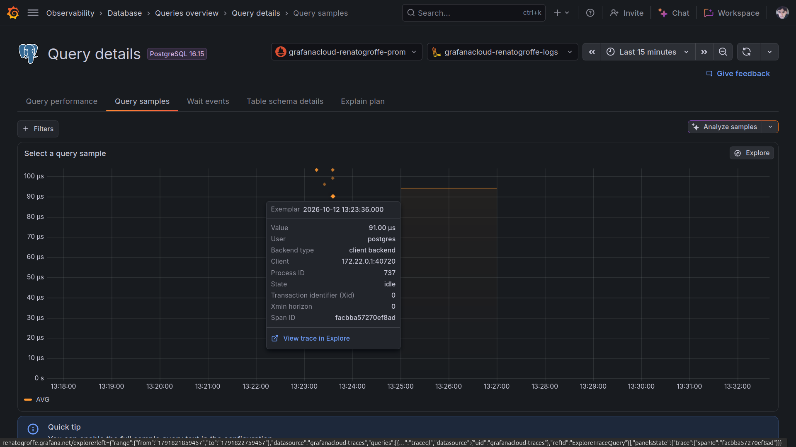
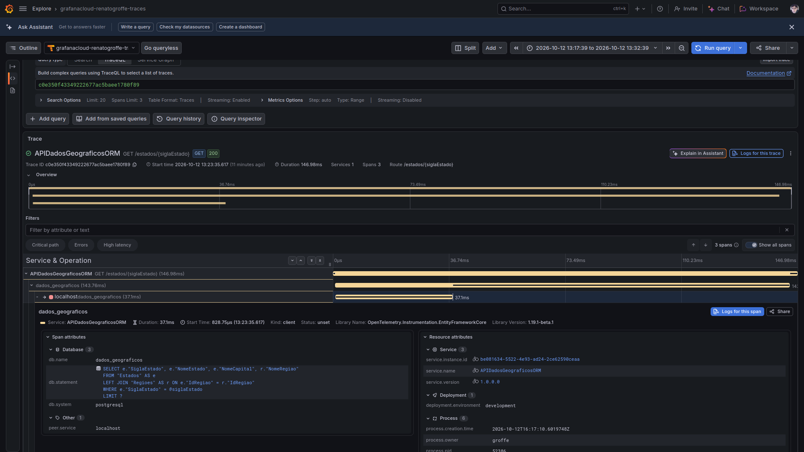
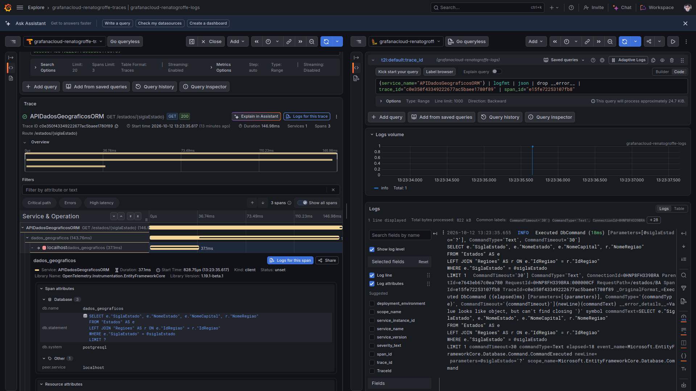
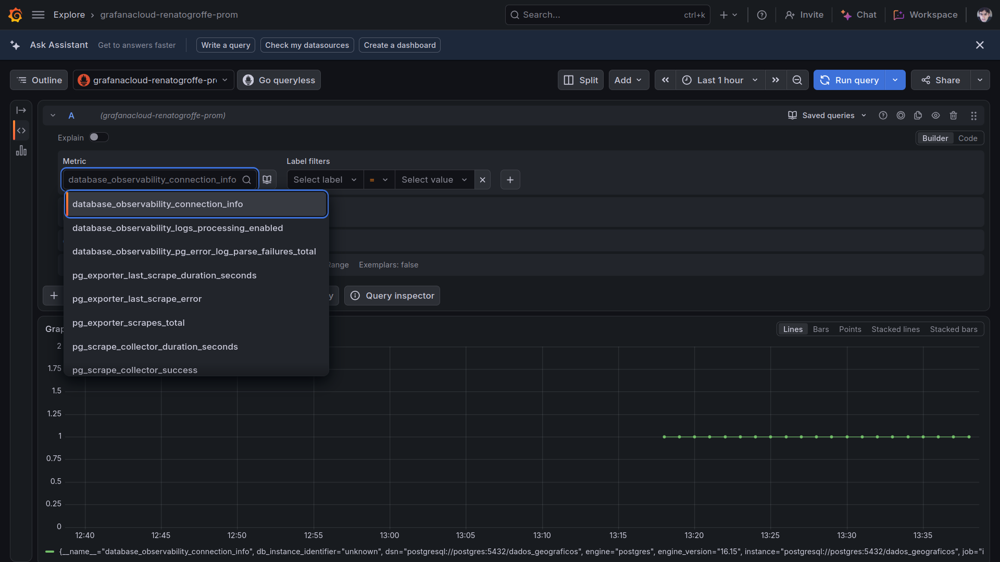
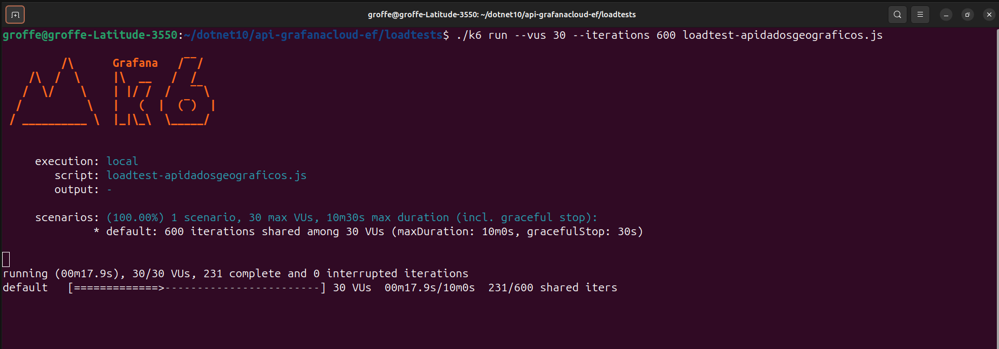
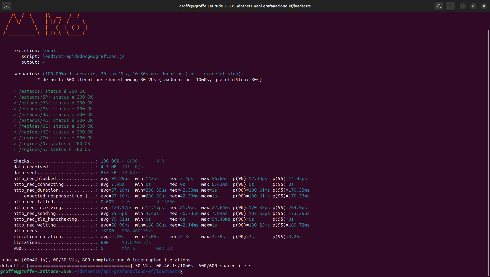

# aspnetcore10-otel-grafanacloud-alloy-dbobservability-postgres_contagemacessos
Exemplo de uso de OpenTelemetry + Grafana Cloud + Alloy (collector) + Tempo (trace) + Loki (logs) + Prometheus (métricas) em uma API REST de dados geográficos baseada em .NET 10 + ASPNET Core e que utiliza PostgreSQL. Inclui scripts do k6 e do Docker Compose para criação de instância do PostgreSQL e do Grafana Alloy (com Database Observability).

## Testes

Visualizando métricas e logs coletados através da funcionalidade **Queries overview (Database Observability)**:

Algumas queries que foram executadas:

Consultando detalhes de uma dessas queries:

A funcionalidade **Query samples**:

Visualizando detalhes de uma query de exemplo, com o link para o trace correspondente:

Visualizando o trace de uma query de exemplo no Grafana Tempo:

Detalhes da query no trace e logs associados ao mesmo:

Algumas métricas coletadas via Prometheus:

Testes executados via k6 para geração dos resultados de instrumentação:

